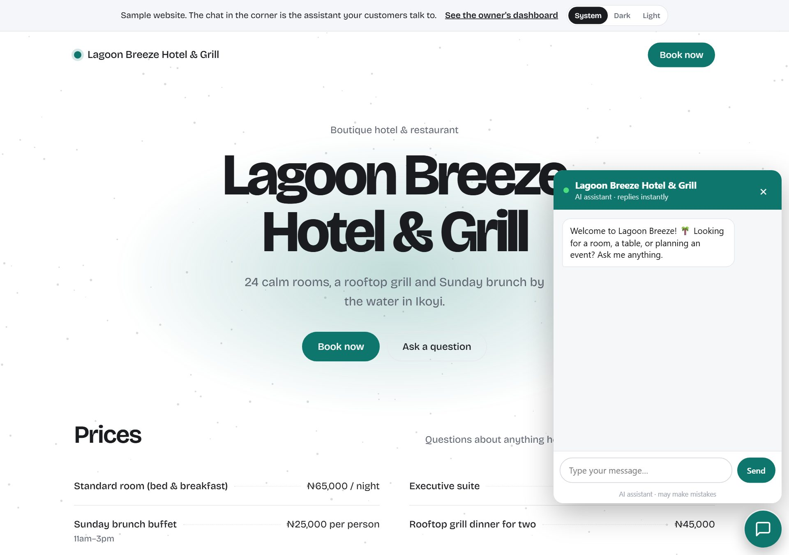
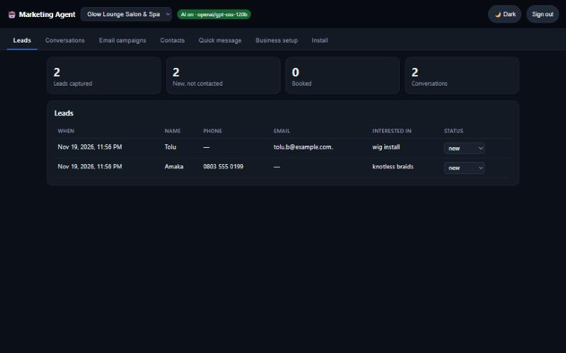
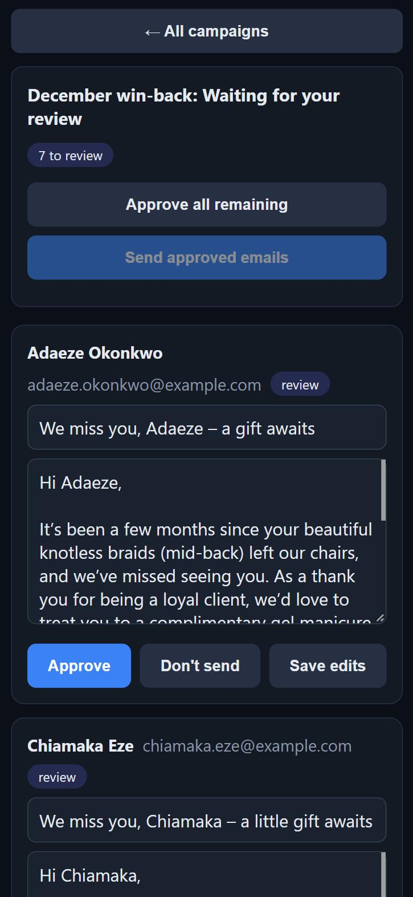

# Marketing Agent

**An AI marketing assistant that helps local businesses win back old customers and catch new ones.**

Most customers don't leave because they're unhappy. They just forget. Marketing Agent takes a business's customer list, writes a warm, personal email to each person who hasn't been back in a while, and puts a 24/7 chat assistant on the business's website that answers questions and captures leads.


## Features

- **Personal win-back campaigns.** Pick a goal ("bring back clients who haven't visited in 90 days") and the AI writes a different email for every customer, using their name and usual service. Goals: win-back, promotions, review requests, thank-yous to regulars, and partnership pitches to other local businesses.
- **Referral campaigns that bring in new customers.** Happy customers get a personal invite link (plus a one-tap WhatsApp share). Their friend opens it, sees the offer ("you both get 10% off"), and leaves their details. The business gets a new inquiry tagged *"invited by Adaeze"*, and the dashboard counts how many friends each customer brought in.
- **WhatsApp & Instagram auto-replies.** Customers who message the business on WhatsApp or Instagram get an instant, accurate answer (prices, hours, booking) day or night, through Meta's official APIs. Real conversations become new inquiries automatically.
- **Follow-ups so nobody slips through.** Inquiries that haven't heard back in 24 hours are flagged ⏰. One click writes a friendly follow-up to send by email, or opens the owner's own WhatsApp with the message already typed.
- **Instant new-customer alerts.** The owner is emailed the moment someone new leaves their details (website chat, WhatsApp, Instagram or an invite link), so they can reply while the person is still interested.
- **Owner approves everything.** Every email lands in a review queue to edit, approve or skip. Nothing is sent automatically.
- **Website chat assistant.** One line of code adds a chat bubble to any website (WordPress, Wix, Shopify…). It answers prices, hours and FAQs from the business profile, and saves visitors who leave a phone number or email as new inquiries.
- **One engine, any business.** Each business is a simple profile: services, prices (any currency), hours, FAQs, offers and tone of voice. The AI only uses what's in the profile.
- **Personal, never creepy.** The AI only sees a short list of friendly facts: first name, last service, and a *vague* "a few months" instead of exact dates. Private notes and phone numbers never reach the AI.
- **Works everywhere.** Responsive on phones, tablets and desktop, with light, dark and system themes. Installable as an app on phones and computers (PWA).
- **Runs for $0.** Works with any OpenAI-compatible API (Groq's free tier by default), has an offline fallback mode, and a test mode for email so demos never contact real people.

| Website chat | New inquiries |
|---|---|
|  |  |

<p align="center"></p>

## Quick start

Requires [Node.js](https://nodejs.org) 22.9 or newer (24 LTS recommended).

```bash
git clone https://github.com/ijioku/marketing-agent.git
cd marketing-agent
npm install
npm start
```

Open **http://localhost:3000/admin** and sign in with the default password `changeme`.

It runs immediately in offline mode. For real AI writing:

1. Copy `.env.example` to `.env`
2. Get a free API key from [Groq](https://console.groq.com/keys) and set `AI_API_KEY=...`
3. Set a strong `ADMIN_PASSWORD`, then restart

## How it works

1. **Business setup:** describe the business (services, prices, hours, FAQs, offers, tone).
2. **Contacts:** import the customer list as a CSV exported from any booking or POS system. Column names are matched automatically. Try `public/sample-contacts.csv`.
3. **Email campaigns:** choose a goal and audience; the AI drafts one email per customer in the background.
4. **Review & send:** edit, approve or skip each email, then send. Every email includes the business address and a working unsubscribe link.
5. **Install:** paste one line on the business's website to add the chat assistant, and optionally connect WhatsApp and Instagram.
6. **New inquiries:** everyone who reaches out shows up here with where they came from. Follow up with one click.

Two sample businesses are included: a Lekki hair salon and a Victoria Island gym, priced in naira.

## Security

- Login lockout: 5 wrong passwords triggers a timed lock (15 min, doubling up to 1 hour), plus a global pause if more than 50 wrong passwords arrive from anywhere within 15 minutes (stops botnets)
- Session tokens in HttpOnly, SameSite=Strict cookies; the password is never stored in the browser
- Constant-time password comparison, CSRF origin checks, strict security headers (CSP, no framing)
- Rate limits on the public chat, invite pages and WhatsApp/Instagram senders to stop spam and API cost abuse
- WhatsApp/Instagram webhooks only accept messages signed by Meta with your app secret (HMAC-SHA256); unsigned or forged calls are rejected
- Referral claims are de-duplicated by phone and email so rewards can't be gamed; hidden-field bot trap on the invite form
- Input validation, request size limits, no internal error details exposed
- Refuses to start in production with a weak password
- Marketing consent respected, unsubscribe links on every email, and consent re-checked right before sending

## Tech stack

**Node.js** · **Express 5** · vanilla **JavaScript, HTML & CSS** (no frontend framework) · any **OpenAI-compatible LLM API** (Groq, Gemini, OpenRouter) · **Brevo / Resend** for email · JSON files locally or PostgreSQL (Neon) in production

## Project structure

```
server.js            Web server, routes, login and rate limits
lib/ai.js            Chat replies, lead capture, personalized email writing
lib/campaigns.js     Audience selection, drafting queue, approval and sending
lib/contacts.js      CSV import, consent and unsubscribe handling
lib/mailer.js        Email delivery (test mode, Brevo, Resend)
lib/social.js        WhatsApp & Instagram webhooks and replies (Meta APIs)
lib/security.js      Sessions, login lockout, rate limiting, security headers
lib/businesses.js    Business profiles
lib/store.js         Storage: JSON files locally, PostgreSQL when DATABASE_URL is set
public/admin.html    Owner dashboard
public/widget.js     Embeddable website chat widget
public/demo.html     Demo website for each business
public/sw.js         Service worker + manifest: installable app (PWA)
businesses/*.json    One profile per client business
```

## Configuration

All settings live in `.env` (see `.env.example`):

| Setting | Purpose |
|---|---|
| `ADMIN_PASSWORD` | Dashboard password (10+ characters before going online) |
| `AI_API_KEY`, `AI_BASE_URL`, `AI_MODEL` | Any OpenAI-compatible provider |
| `EMAIL_PROVIDER` | `log` (test mode, default), `brevo` or `resend` |
| `EMAIL_API_KEY`, `EMAIL_FROM_ADDRESS` | Email provider credentials |
| `PUBLIC_URL` | Public address used in unsubscribe links |
| `SEND_DAILY_LIMIT`, `SEND_DELAY_MS` | Sending pace per business, to protect sender reputation |
| `META_APP_SECRET`, `META_VERIFY_TOKEN` | Secure the WhatsApp/Instagram webhook |
| `WHATSAPP_ACCESS_TOKEN`, `WHATSAPP_ROUTES` | Send WhatsApp replies; map phone-number IDs to businesses |
| `INSTAGRAM_ACCESS_TOKEN`, `INSTAGRAM_ROUTES` | Send Instagram replies; map Instagram account IDs to businesses |
| `FOLLOW_UP_AFTER_HOURS` | When an unanswered inquiry gets flagged ⏰ (default 24) |
| `TRUST_PROXY` | Set to `1` behind a hosting proxy so rate limits see real visitor IPs |

## Deploy

### Free: Render + Neon (no credit card)

1. **Database:** create a free project at [neon.tech](https://neon.tech) and copy its connection string (`postgresql://…`).
2. **App:** at [render.com](https://render.com) choose **New → Blueprint** and select this repo (it reads `render.yaml`).
3. Paste the secrets Render asks for: `ADMIN_PASSWORD` (10+ characters), `DATABASE_URL` (from Neon), `AI_API_KEY` (Groq), and `PUBLIC_URL` (your Render address, e.g. `https://marketing-agent-xxxx.onrender.com`; you can fill it in after the first deploy).
4. Open `https://YOUR-APP.onrender.com/admin`.

Free-plan trade-off: the app sleeps after ~15 minutes without visitors and takes ~50 seconds to wake up.

### Paid / persistent disk

On Railway, Render paid, Fly.io or a VPS you can skip the database: mount a disk at `/data` and set `DATA_DIR=/data` instead of `DATABASE_URL`. Also set `NODE_ENV=production`, `TRUST_PROXY=1`, `ADMIN_PASSWORD`, `PUBLIC_URL` and `AI_API_KEY`. Health check path: `/healthz`.

## WhatsApp & Instagram setup

Auto-replies use Meta's official business APIs. Until access tokens are added, replies are saved to `data/social_outbox.json` (test mode).

1. **Deploy the app** to a public HTTPS address (Meta can't reach `localhost`).
2. Create an app at [developers.facebook.com](https://developers.facebook.com) and add the **WhatsApp** and/or **Instagram** products.
3. In `.env`, set `META_APP_SECRET` (App settings → Basic) and choose any long random `META_VERIFY_TOKEN`.
4. Under **Webhooks**, set the callback URL to `https://YOUR-DOMAIN/webhooks/meta`, enter the same verify token, and subscribe to **messages**.
5. **WhatsApp:** copy the *Phone number ID* and an access token into `.env`: `WHATSAPP_ACCESS_TOKEN=...` and `WHATSAPP_ROUTES=<phone-number-id>:<business-id>`.
6. **Instagram:** connect the business's Instagram professional account to a Facebook Page, then set `INSTAGRAM_ACCESS_TOKEN=<page access token>` and `INSTAGRAM_ROUTES=<instagram-account-id>:<business-id>`.
7. Restart. The dashboard's **Install** tab shows the connection status.

Meta only allows free-form replies within 24 hours of the customer's last message. That's exactly what auto-replies do. Messages you start yourself later need Meta-approved templates.

## Install as an app (PWA)

Open the dashboard in Chrome (Android/desktop) or Safari (iPhone) and choose **Install app** / **Add to Home Screen**. It opens full-screen with its own icon. Installing on a phone requires the app to be served over **HTTPS** (i.e. deployed); `localhost` works for desktop testing.

## Roadmap

- [x] Referral program with invite links
- [x] WhatsApp & Instagram auto-replies
- [x] Follow-up tool for unanswered inquiries
- [x] Installable app (PWA)
- [ ] WhatsApp broadcast campaigns (Meta-approved templates)
- [ ] Results page: replies and bookings per campaign
- [ ] Simpler guided onboarding for business owners
- [ ] PostgreSQL storage, multi-user accounts and one-click deployment
- [ ] Native iOS/Android apps (Capacitor) and app-store listing
