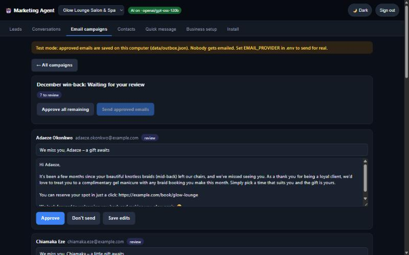

# Marketing Agent

**An AI marketing assistant that helps local businesses win back old customers and catch new ones.**

Most customers don't leave because they're unhappy. They just forget. Marketing Agent takes a business's customer list, writes a warm, personal email to each person who hasn't been back in a while, and puts a 24/7 chat assistant on the business's website that answers questions and captures leads.



## Features

- **Personal win-back campaigns.** Pick a goal ("bring back clients who haven't visited in 90 days") and the AI writes a different email for every customer, using their name and usual service. Goals: win-back, promotions, review requests, thank-yous to regulars, and partnership pitches to other local businesses.
- **Owner approves everything.** Every email lands in a review queue to edit, approve or skip. Nothing is sent automatically.
- **Website chat assistant.** One line of code adds a chat bubble to any website (WordPress, Wix, Shopify…). It answers prices, hours and FAQs from the business profile, and saves visitors who leave a phone number or email as leads.
- **One engine, any business.** Each business is a simple profile: services, prices (any currency), hours, FAQs, offers and tone of voice. The AI only uses what's in the profile.
- **Personal, never creepy.** The AI only sees a short list of friendly facts: first name, last service, and a *vague* "a few months" instead of exact dates. Private notes and phone numbers never reach the AI.
- **Works everywhere.** Responsive on phones, tablets and desktop, with light, dark and system themes.
- **Runs for $0.** Works with any OpenAI-compatible API (Groq's free tier by default), has an offline fallback mode, and a test mode for email so demos never contact real people.

| Website chat | Captured leads |
|---|---|
|  |  |

<p align="center"></p>

## Quick start

Requires [Node.js](https://nodejs.org) 22.9 or newer (24 LTS recommended).

```bash
git clone https://github.com/ijioku/marketing-agent.git
cd marketing-agent
npm install
npm start
```

Open **http://localhost:3000/admin** and sign in with the default password `changeme`.

It runs immediately in offline mode. For real AI writing:

1. Copy `.env.example` to `.env`
2. Get a free API key from [Groq](https://console.groq.com/keys) and set `AI_API_KEY=...`
3. Set a strong `ADMIN_PASSWORD`, then restart

## How it works

1. **Business setup:** describe the business (services, prices, hours, FAQs, offers, tone).
2. **Contacts:** import the customer list as a CSV exported from any booking or POS system. Column names are matched automatically. Try `public/sample-contacts.csv`.
3. **Email campaigns:** choose a goal and audience; the AI drafts one email per customer in the background.
4. **Review & send:** edit, approve or skip each email, then send. Every email includes the business address and a working unsubscribe link.
5. **Install:** paste one line on the business's website to add the chat assistant. New leads appear in the dashboard.

Two sample businesses are included: a Lekki hair salon and a Victoria Island gym, priced in naira.

## Security

- Login lockout: 5 wrong passwords triggers a timed lock (15 min, doubling up to 1 hour)
- Session tokens in HttpOnly, SameSite=Strict cookies; the password is never stored in the browser
- Constant-time password comparison, CSRF origin checks, strict security headers (CSP, no framing)
- Rate limits on the public chat to stop spam and API cost abuse
- Input validation, request size limits, no internal error details exposed
- Refuses to start in production with a weak password
- Marketing consent respected, unsubscribe links on every email, and consent re-checked right before sending

## Tech stack

**Node.js** · **Express 5** · vanilla **JavaScript, HTML & CSS** (no frontend framework) · any **OpenAI-compatible LLM API** (Groq, Gemini, OpenRouter) · **Brevo / Resend** for email · JSON file storage

## Project structure

```
server.js            Web server, routes, login and rate limits
lib/ai.js            Chat replies, lead capture, personalized email writing
lib/campaigns.js     Audience selection, drafting queue, approval and sending
lib/contacts.js      CSV import, consent and unsubscribe handling
lib/mailer.js        Email delivery (test mode, Brevo, Resend)
lib/security.js      Sessions, login lockout, rate limiting, security headers
lib/businesses.js    Business profiles
lib/store.js         JSON file storage
public/admin.html    Owner dashboard
public/widget.js     Embeddable website chat widget
public/demo.html     Demo website for each business
businesses/*.json    One profile per client business
```

## Configuration

All settings live in `.env` (see `.env.example`):

| Setting | Purpose |
|---|---|
| `ADMIN_PASSWORD` | Dashboard password (10+ characters before going online) |
| `AI_API_KEY`, `AI_BASE_URL`, `AI_MODEL` | Any OpenAI-compatible provider |
| `EMAIL_PROVIDER` | `log` (test mode, default), `brevo` or `resend` |
| `EMAIL_API_KEY`, `EMAIL_FROM_ADDRESS` | Email provider credentials |
| `PUBLIC_URL` | Public address used in unsubscribe links |
| `SEND_DAILY_LIMIT`, `SEND_DELAY_MS` | Sending pace, to protect sender reputation |

## Roadmap

- [ ] WhatsApp campaigns and chat (WhatsApp Business API)
- [ ] Results page: replies and bookings per campaign
- [ ] Automatic follow-ups
- [ ] Simpler guided onboarding for business owners
- [ ] PostgreSQL storage and one-click deployment
- [ ] Installable mobile app (PWA)
