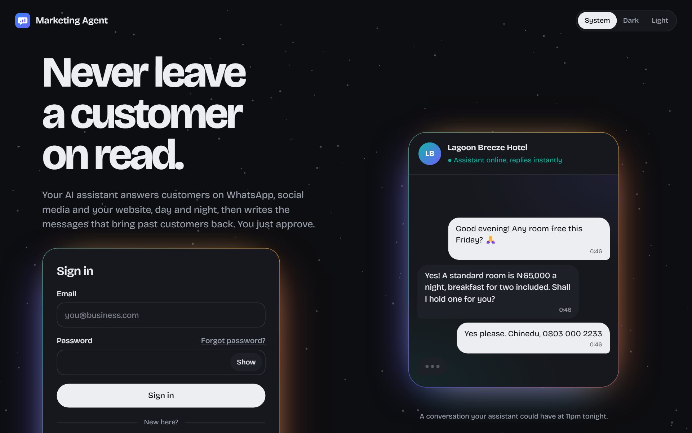
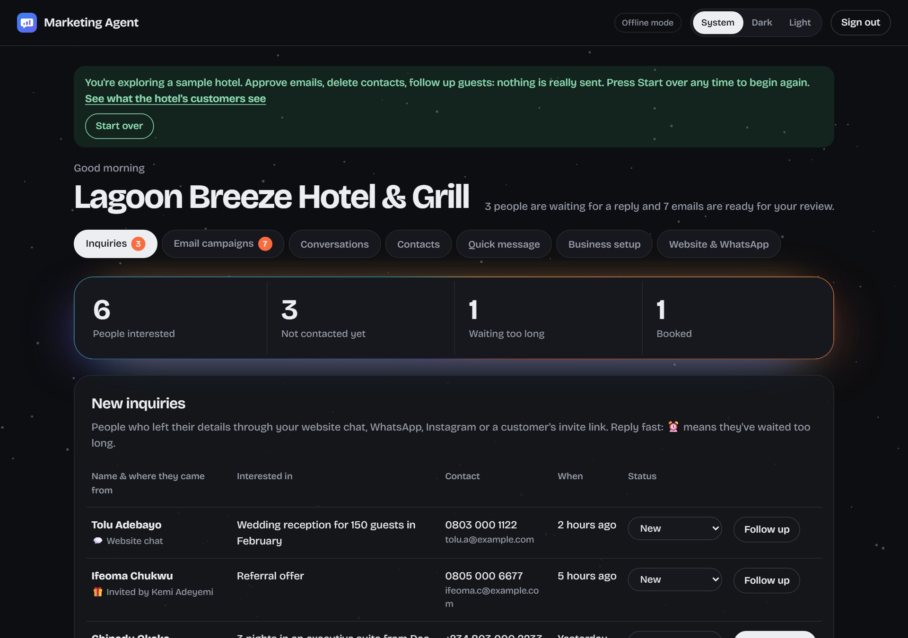
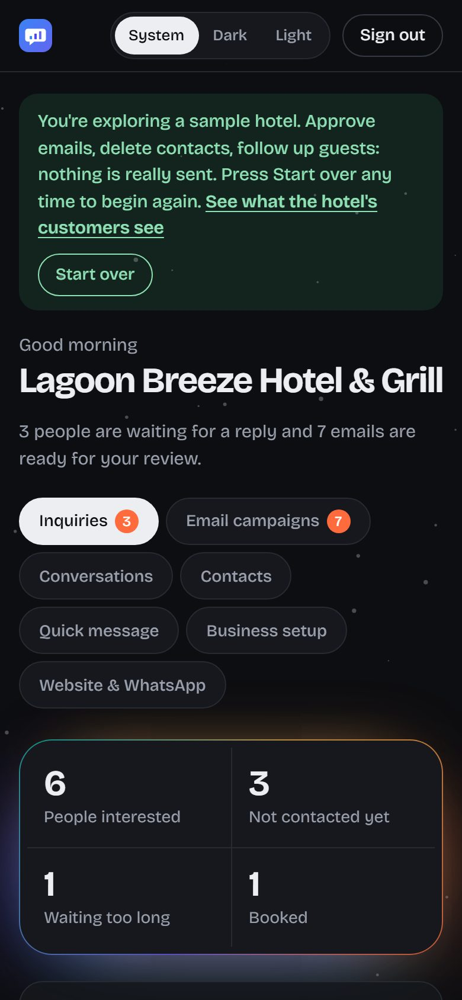

# Marketing Agent

**An AI assistant that answers a business's customers day and night, and brings old customers back.**

Most customers don't leave because they're unhappy. They just forget, or they message at 11pm and nobody answers. Marketing Agent answers on WhatsApp, Instagram and the business's website, saves everyone who gets in touch as an inquiry, and writes a warm, personal message to each customer who hasn't been back in a while. The owner approves everything before it goes out.

**Live demo:** [marketing-agent-8qmi.onrender.com/admin](https://marketing-agent-8qmi.onrender.com/admin) → click **Try the demo** (no sign-up). It may take ~50 seconds to wake up.



## Features

- **Answers customers 24/7.** A chat assistant on the business's website, WhatsApp and Instagram replies instantly with accurate prices, hours and booking details from the business profile. Anyone who leaves a name, phone or email becomes a new inquiry.
- **Personal win-back campaigns.** Pick a goal ("bring back guests who haven't stayed in 90 days") and the AI writes a different email for every customer, using their name and usual service. Goals: win-back, promotions, review requests, thank-yous to regulars, and partnership pitches.
- **Owner approves everything.** Every email lands in a review queue to edit, approve or skip. Nothing is sent automatically.
- **Referral campaigns that bring in new customers.** Happy customers get a personal invite link with a one-tap WhatsApp share. Their friend sees the offer and leaves their details; the business gets an inquiry tagged *"invited by Adaeze"*. Shared invite links show a rich preview card on WhatsApp.
- **Follow-ups so nobody slips through.** Inquiries waiting 24 hours are flagged ⏰. One click writes a friendly follow-up to send by email, or opens the owner's WhatsApp with the message typed.
- **Instant new-customer alerts** by email the moment someone new gets in touch.
- **A login for every business.** The main admin sees every business; each business owner signs in and sees only their own. Sign in with email and password or **Continue with Google**, with a working **Forgot password** flow.
- **One-click demo for prospects.** "Try the demo" opens a sample hotel with realistic guests, inquiries and emails to approve. Nothing is really sent, and **Start over** resets it instantly (handy for recording demo videos). It also resets itself after 30 idle minutes.
- **An interface people remember.** An interactive dot field that reacts to the mouse, touch and scrolling on every page, light/dark/system themes, and layouts tested on phones, foldables, iPads and desktops. Installable as an app (PWA).
- **Personal, never creepy.** The AI sees only a short list of friendly facts: first name, last service, and a vague "a few months" instead of exact dates. Private notes never reach the AI.
- **Runs for $0.** Any OpenAI-compatible API (Groq's free tier by default), an offline fallback mode, and an email test mode so demos never contact real people.

| Owner dashboard | Website chat |
|---|---|
|  |  |

| Email review | On a phone |
|---|---|
|  |  |

## Quick start

Requires [Node.js](https://nodejs.org) 22.9 or newer (24 LTS recommended).

```bash
git clone https://github.com/ijioku/marketing-agent.git
cd marketing-agent
npm install
npm start
```

Open **http://localhost:3000/admin**. Leave the email empty and sign in with the default password `changeme`, or click **Try the demo**.

It runs immediately in offline mode. For real AI writing:

1. Copy `.env.example` to `.env`
2. Get a free API key from [Groq](https://console.groq.com/keys) and set `AI_API_KEY=...`
3. Set a strong `ADMIN_PASSWORD`, then restart

## Who signs in

| Who | How they sign in | What they see |
|---|---|---|
| **Main admin** (you) | Email empty, `admin` or `ADMIN_EMAIL`, plus `ADMIN_PASSWORD`; or Continue with Google with `ADMIN_EMAIL` | Every business; creates owner logins (Business setup → Owner logins) |
| **Business owner** | The email and password the admin created for them; or Continue with Google with that email | Only their own business. Can change their password |
| **Prospect** | **Try the demo**, no password | The sample hotel. Can't send real messages, import contacts or change settings |

## How it works

1. **Business setup:** describe the business (services, prices, hours, FAQs, offers, tone).
2. **Contacts:** import the customer list as a CSV from any booking or POS system. Column names are matched automatically. Try `public/sample-contacts.csv`.
3. **Email campaigns:** choose a goal and audience; the AI drafts one email per customer in the background.
4. **Review & send:** edit, approve or skip each email, then send. Every email includes the business address and a working unsubscribe link.
5. **Website & WhatsApp:** paste one line on the business's website to add the chat assistant, and optionally connect WhatsApp and Instagram.
6. **Inquiries:** everyone who reaches out shows up with where they came from. Follow up with one click.

Sample businesses are included: a Lagos hotel (the demo), a Lekki hair salon and a Victoria Island gym, priced in naira.

## Security

- Owner passwords hashed with scrypt and a unique salt; constant-time checks; unknown emails take as long as wrong passwords, so accounts can't be discovered
- Each owner can only reach their own business: every request is checked on the server, and other businesses answer "Not found"
- Login lockout: 5 wrong passwords triggers a timed lock (15 min, doubling up to 1 hour), plus a global pause if more than 50 wrong passwords arrive from anywhere within 15 minutes
- Password reset links are random, stored only as a hash, expire after 30 minutes, work once, and sign the account out everywhere
- Google sign-in tokens are verified on the server against Google's public keys (signature, audience, expiry, verified email); only existing accounts can use it
- Session tokens in HttpOnly, SameSite=Strict cookies; CSRF origin checks; strict security headers (CSP, no framing, HSTS)
- Rate limits on sign-in, password reset, the public chat, invite pages and WhatsApp/Instagram senders
- WhatsApp/Instagram webhooks only accept messages signed by Meta (HMAC-SHA256)
- The demo can never send email, import contacts or touch real businesses
- Refuses to start in production with a weak password
- Marketing consent respected, unsubscribe links on every email, consent re-checked right before sending
- Privacy policy (`/privacy`) and terms (`/terms`) written for the Nigeria Data Protection Act 2023

## Tech stack

**Node.js** · **Express 5** · vanilla **JavaScript, HTML & CSS** (no frontend framework) · any **OpenAI-compatible LLM API** (Groq, Gemini, OpenRouter) · **Brevo / Resend** for email · **Google Identity Services** · JSON files locally or PostgreSQL (Neon) in production

## Project structure

```
server.js            Web server, routes, sign-in, permissions, rate limits, SEO files
lib/accounts.js      Owner logins: hashed passwords, password resets
lib/google.js        Verifies "Continue with Google" tokens
lib/demo.js          The sample hotel and its automatic / "Start over" reset
lib/ai.js            Chat replies, lead capture, personalized email writing
lib/campaigns.js     Audience selection, drafting queue, approval and sending
lib/contacts.js      CSV import, consent and unsubscribe handling
lib/mailer.js        Email delivery (test mode, Brevo, Resend)
lib/social.js        WhatsApp & Instagram webhooks and replies (Meta APIs)
lib/security.js      Sessions, login lockout, rate limiting, security headers
lib/legal.js         Privacy policy and terms of service
lib/businesses.js    Business profiles
lib/store.js         Storage: JSON files locally, PostgreSQL when DATABASE_URL is set
public/admin.html    Sign-in page and dashboard
public/demo.html     Customer-facing website for each business
public/widget.js     Embeddable website chat widget
public/motion.js     Interactive dot-field background
public/sw.js         Service worker + manifest: installable app (PWA)
businesses/*.json    One profile per client business
```

## Configuration

All settings live in `.env` (see `.env.example`), or in your host's environment settings:

| Setting | Purpose |
|---|---|
| `ADMIN_PASSWORD` | Main admin password (10+ characters before going online) |
| `ADMIN_EMAIL` | Optional: lets the admin sign in with this email, and with Google |
| `GOOGLE_CLIENT_ID` | Optional: shows "Continue with Google" (see below) |
| `SUPPORT_EMAIL` | Optional: contact address shown on the privacy and terms pages |
| `PUBLIC_URL` | The site's public address, used in emails, reset links, link previews and the sitemap |
| `AI_API_KEY`, `AI_BASE_URL`, `AI_MODEL` | Any OpenAI-compatible provider |
| `EMAIL_PROVIDER` | `log` (test mode, default), `brevo` or `resend` |
| `EMAIL_API_KEY`, `EMAIL_FROM_ADDRESS` | Email provider credentials |
| `DATABASE_URL` | PostgreSQL connection (e.g. Neon). Without it, data is saved as JSON files |
| `DATA_DIR` | Where JSON data is stored when there's no database |
| `SEND_DAILY_LIMIT`, `SEND_DELAY_MS` | Sending pace per business, to protect sender reputation |
| `META_APP_SECRET`, `META_VERIFY_TOKEN` | Secure the WhatsApp/Instagram webhook |
| `WHATSAPP_ACCESS_TOKEN`, `WHATSAPP_ROUTES` | Send WhatsApp replies; map phone-number IDs to businesses |
| `INSTAGRAM_ACCESS_TOKEN`, `INSTAGRAM_ROUTES` | Send Instagram replies; map Instagram account IDs to businesses |
| `FOLLOW_UP_AFTER_HOURS` | When an unanswered inquiry gets flagged ⏰ (default 24) |
| `TRUST_PROXY` | Set to `1` behind a hosting proxy so rate limits see real visitor IPs |

## Deploy

### Free: Render + Neon (no credit card)

1. **Database:** create a free project at [neon.tech](https://neon.tech) and copy its connection string (`postgresql://…`).
2. **App:** at [render.com](https://render.com) choose **New → Blueprint** and select this repo (it reads `render.yaml`).
3. Paste the secrets Render asks for: `ADMIN_PASSWORD` (10+ characters), `DATABASE_URL` (from Neon), `AI_API_KEY` (Groq), and `PUBLIC_URL` (your Render address, e.g. `https://marketing-agent-xxxx.onrender.com`; you can fill it in after the first deploy). Optionally `ADMIN_EMAIL`, `GOOGLE_CLIENT_ID` and `SUPPORT_EMAIL`.
4. Open `https://YOUR-APP.onrender.com/admin`.

Free-plan trade-off: the app sleeps after ~15 minutes without visitors and takes ~50 seconds to wake up.

### Paid / persistent disk

On Railway, Render paid, Fly.io or a VPS you can skip the database: mount a disk at `/data` and set `DATA_DIR=/data` instead of `DATABASE_URL`. Also set `NODE_ENV=production`, `TRUST_PROXY=1`, `ADMIN_PASSWORD`, `PUBLIC_URL` and `AI_API_KEY`. Health check path: `/healthz`.

## Continue with Google setup

1. At [console.cloud.google.com](https://console.cloud.google.com) create a project, then open **Google Auth Platform → Get started** (audience: External).
2. **Clients → Create client → Web application.** Under *Authorized JavaScript origins* add your site (e.g. `https://marketing-agent-xxxx.onrender.com`) and `http://localhost:3000`. Leave redirect URIs empty.
3. Copy the **Client ID** into `GOOGLE_CLIENT_ID` (it's public; the client secret isn't needed).
4. While the app is in *Testing*, add each Google account that should sign in under **Audience → Test users**, or publish the app once the Branding page is complete.

Only the admin (`ADMIN_EMAIL`) and owners with an existing login can sign in with Google.

## WhatsApp & Instagram setup

Auto-replies use Meta's official business APIs. Until access tokens are added, replies are saved to `data/social_outbox.json` (test mode).

1. **Deploy the app** to a public HTTPS address (Meta can't reach `localhost`).
2. Create an app at [developers.facebook.com](https://developers.facebook.com) and add the **WhatsApp** and/or **Instagram** products.
3. Set `META_APP_SECRET` (App settings → Basic) and choose any long random `META_VERIFY_TOKEN`.
4. Under **Webhooks**, set the callback URL to `https://YOUR-DOMAIN/webhooks/meta`, enter the same verify token, and subscribe to **messages**.
5. **WhatsApp:** copy the *Phone number ID* and an access token: `WHATSAPP_ACCESS_TOKEN=...` and `WHATSAPP_ROUTES=<phone-number-id>:<business-id>`.
6. **Instagram:** connect the business's Instagram professional account to a Facebook Page, then set `INSTAGRAM_ACCESS_TOKEN=<page access token>` and `INSTAGRAM_ROUTES=<instagram-account-id>:<business-id>`.
7. Restart. The dashboard's **Website & WhatsApp** tab shows the connection status.

Meta only allows free-form replies within 24 hours of the customer's last message. That's exactly what auto-replies do. Messages you start yourself later need Meta-approved templates.

## Search and sharing

The sign-in page has a search description, Open Graph tags with a share image (`public/og.png`) for WhatsApp/Facebook previews, and structured data. `/sitemap.xml` and `/robots.txt` list the public pages; demo, invite and unsubscribe pages are marked `noindex`. Submit `/sitemap.xml` in [Google Search Console](https://search.google.com/search-console) to get indexed faster.

## Install as an app (PWA)

Open the dashboard in Chrome (Android/desktop) or Safari (iPhone) and choose **Install app** / **Add to Home Screen**. It opens full-screen with its own icon. Installing on a phone requires HTTPS (i.e. deployed); `localhost` works for desktop testing.

## Roadmap

- [x] Referral program with invite links
- [x] WhatsApp & Instagram auto-replies
- [x] Follow-up tool for unanswered inquiries
- [x] Installable app (PWA)
- [x] PostgreSQL storage and one-click deployment
- [x] A login for every business owner, Google sign-in and password resets
- [x] One-click demo with Start over
- [x] Privacy policy and terms
- [ ] Real email delivery (Brevo) and a custom domain
- [ ] WhatsApp send button for campaign messages, then WhatsApp broadcast campaigns (Meta-approved templates)
- [ ] Facebook Messenger replies
- [ ] Results page: replies and bookings per campaign
- [ ] Android app (APK, then Google Play) and iOS
